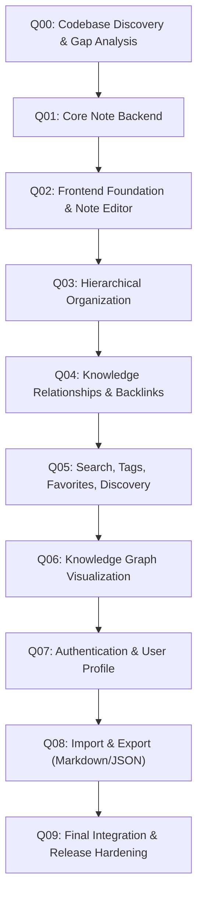

# Master Orchestrator — Knowledge App

## 1. Role and Principles
The Master Orchestrator is the autonomous governing system responsible for executing the Knowledge App Development Roadmap across queues Q00 through Q09.

### Core Principles
1. **Notes are the center of the entire application.**
2. **Hierarchy and relationships are independent**:
   - `parentId` governs tree hierarchy.
   - `NoteRelationship` governs directional graph connections.
   - Reparenting or moving notes never alters or removes knowledge graph connections.
3. **Strict Technology Constraints**:
   - Pure JavaScript (ES6+), zero TypeScript (`.js` and `.jsx` only).
   - Monorepo with npm workspaces (`frontend`, `backend`).
   - PostgreSQL with Prisma ORM (`@prisma/client` as single data access layer).
   - REST API with `/api/v1` prefix.
   - No Docker, no microservices, no MongoDB/Mongoose.

---

## 2. Queue Execution Pipeline

---

## 3. Quality Gate Enforcements
Every queue must pass its quality gates before advancing:
1. **ESLint Verification**: `npm run lint` must exit with 0 errors and 0 warnings.
2. **Automated Unit & Integration Testing**: `npm test` must pass all tests with 0 failures.
3. **Production Build**: `npm run build --workspace=frontend` must compile cleanly via Vite.
4. **Prisma Schema Integrity**: Schema must validate and generate cleanly (`prisma generate`).
5. **State Synchronization**: `.agent/EXECUTION_STATE.md`, `.agent/EXECUTION_LOG.md`, `.agent/IMPLEMENTATION_CHECKLIST.md`, and `.agent/PROJECT_GAP_ANALYSIS.md` must be updated at each milestone.
