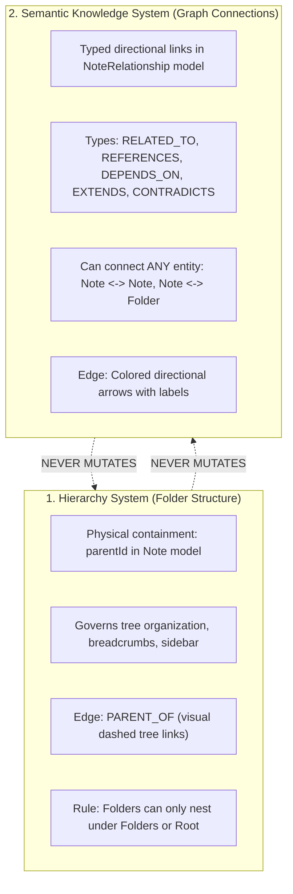

# KNOWLEDGE GRAPH UPGRADE REPORT — FOLDER-CENTRIC KNOWLEDGE GRAPH

## 1. Executive Summary

This report documents the architectural and feature upgrade of the **Knowledge App** into a **Folder-Centric Knowledge Graph System**.

The upgrade transforms the application from a single flat global graph into an organized, scalable workspace experience inspired by **Obsidian** (interconnected knowledge nodes), **Notion** (clean hierarchical workspaces), and **File Explorer** (familiar folder tree).

---

## 2. Core Architecture: Strict Separation of Two Relationship Systems

The most critical architectural principle upheld in this implementation is the **complete independence of Hierarchy Relationships and Semantic Knowledge Relationships**.

- **Moving a Note/Folder in the tree**: Updates `parentId` only. All existing `NoteRelationship` records (outgoing and incoming) remain 100% intact.
- **Creating or Deleting a Semantic Relationship**: Creates or deletes a row in `NoteRelationship` only. The physical folder placement of either note is never altered.

---

## 3. Backend Implementation & REST APIs

### 3.1 Services Updated
- **`backend/src/modules/notes/note.service.js`**:
  - Added hierarchy rule validation in `moveNote`: When moving an entity of type `FOLDER`, the `newParentId` must either be `null` (Root) or point to another entity of type `FOLDER`. Moving a folder inside a note throws a `400 Bad Request` AppError.
- **`backend/src/modules/graph/graph.service.js`**:
  - Implemented `getAllDescendantEntities`: Performs recursive breadth-first traversal across all nesting depths to discover all subfolders, nested notes, and sub-notes under folders.
  - Upgraded `getFolderGraphData`:
    - Collects all multi-level descendants within the folder's domain.
    - Generates multi-level hierarchy edges (`PARENT_OF`) when `includeHierarchy` is enabled.
    - Accurately computes external cross-folder semantic connections for each entity.
    - Supports including external nodes (`isExternal: true`) when semantic edges cross folder boundaries.
  - Implemented `listAllFolders`: Returns a complete listing of all workspace folders along with their direct/recursive item counts and full breadcrumb path for selector interfaces.

### 3.2 REST API Endpoints

| HTTP Method | Route | Description |
|---|---|---|
| `GET` | `/api/v1/graph/folders` | Returns all folders with item counts and breadcrumb paths for the folder selection interface. |
| `GET` | `/api/v1/graph/folders/:folderId` | Returns the complete knowledge graph for a folder (central node, descendants, semantic & hierarchy edges). |
| `GET` | `/api/v1/graph/root` | Returns the root-level workspace graph. |
| `PATCH` | `/api/v1/notes/:id/move` | Moves an entity to a new parent or to root with cycle and type validation. |
| `GET` | `/api/v1/notes/:id/relationships` | Returns outgoing and incoming semantic relationships with backlinks. |
| `POST` | `/api/v1/relationships` | Creates a directional semantic relationship (`sourceNoteId`, `targetNoteId`, `relationshipType`). |
| `DELETE` | `/api/v1/relationships/:id` | Deletes a directional semantic relationship without affecting hierarchy. |

---

## 4. Frontend Implementation & UI Components

### 4.1 Folder Selection Landing Screen (`FolderSelector.jsx`)
- Located at route `/graph`.
- Renders responsive cards for all workspace folders.
- Displays folder name, full path, and item count badge.
- Includes a dedicated card for **Root Workspace**.
- Live search bar allows instant filtering of folders by name.

### 4.2 Central Node & Multi-Level Descendants Graph Canvas (`KnowledgeGraphView.jsx`)
- Located at `/graph/folders/:folderId` and `/graph/root`.
- **Central Node Highlight**: The active scope folder is positioned centrally and rendered with prominent styling (`isCentralNode: true`, glowing amber ring, `ring-4`, badge "Central Folder").
- **Multi-Level Descendants**: Subfolders and nested notes at all levels are laid out in orbital arrangement.
- **Hierarchy Links Toggle**: Defaults to active; renders dashed purple `PARENT_OF` edges connecting parents to children.
- **External Node Badges**: Notes or folders outside the active folder linked by semantic connections are clearly flagged with dashed borders and an "External" badge.
- **Quick Folder Switcher**: Dropdown in the top toolbar enables switching between folder graphs instantly without navigating back to the selection screen.
- **Back to Folders Button**: One-click navigation back to `/graph`.

### 4.3 Unified Connections Drawer (`ConnectionsDrawer.jsx`)
- Replaces legacy separate panels with a slide-out drawer accessible from both the **Note Editor** and **Knowledge Graph** canvas.
- **Section 1 — Current Item Info**: Name, type badge (`FOLDER` / `NOTE`), current parent, and full hierarchy path.
- **Section 2 — Hierarchy Parent Management**:
  - Live dropdown to select a new parent (Folder/Note) or "Root Workspace".
  - Enforces type restrictions (folders cannot be placed inside notes).
  - Validates and catches circular reference errors.
  - Updates hierarchy location with one click without altering semantic connections.
- **Section 3 — Semantic Relationships**:
  - Lists outgoing and incoming (backlinks) relationships with color-coded type badges (`RELATED_TO`, `REFERENCES`, `DEPENDS_ON`, `EXTENDS`, `CONTRADICTS`).
  - "Connect" button opens modal to add new connections to any note or folder.
  - Delete button removes semantic links cleanly with zero impact on the tree hierarchy.

### 4.4 Sidebar & Hierarchy Tree Safeguards (`TreeNode.jsx` & `HierarchyTree.jsx`)
- Tree context menus adapt intelligently: folders show "New Subfolder" and "New Child Note", while notes only show "New Child Note" (preventing folders from nesting under notes).
- Drag-and-drop hierarchy updates display clear operational feedback.

---

## 5. Verification & Test Results

### 5.1 Automated Backend Test Suite
All 7 backend test suites passed cleanly with 100% success rate:
- `user.test.js`: PASS
- `export.test.js`: PASS
- `search.test.js`: PASS
- `relationship.test.js`: PASS
- `graph.test.js`: PASS (including `/graph/folders`, `/graph/root`, `/graph/folders/:folderId`, multi-level descendants, cycle prevention)
- `tag.test.js`: PASS
- `note.test.js`: PASS

**Total: 58 passed, 0 failed.**

### 5.2 Frontend Code Quality & Production Build
- ESLint: `npm run lint --workspace=frontend` passed with **0 errors and 0 warnings**.
- Vite Production Build: `npm run build --workspace=frontend` built successfully in 12.04s (`dist/` generated).

---

## 6. Conclusion

The Folder-Centric Knowledge Graph upgrade is complete, fully tested, and ready for deployment. The architecture cleanly separates hierarchy from semantic relations, provides intuitive folder-level knowledge exploration, and equips users with a unified Connections Drawer across the entire application.
