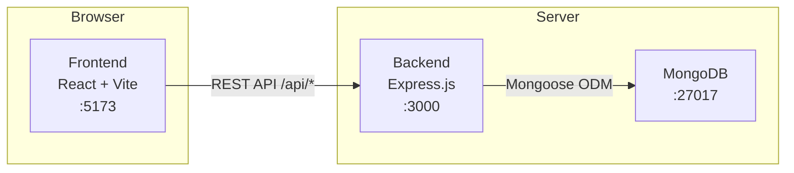
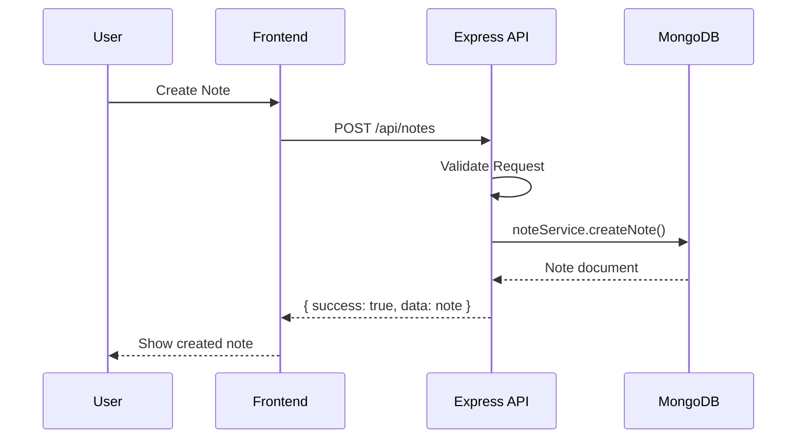

# System Architecture

## Overview

Knowledge App uses a **Monorepo** structure containing two independent applications:

- **Frontend**: React SPA served by Vite dev server (port 5173)
- **Backend**: Express.js REST API server (port 3000)

Communication is exclusively through REST API over HTTP.



## Deployment Model (MVP)

Both frontend and backend run on the same machine during development. In production, they may be deployed independently (frontend as static files, backend as Node.js process).

## Directory Structure

```
knowledge-app/
├── frontend/                 # React SPA
│   ├── src/
│   │   ├── features/         # Feature-based modules
│   │   ├── components/       # Shared UI components
│   │   ├── services/         # API client
│   │   ├── routes/           # Route definitions
│   │   ├── hooks/            # Shared hooks
│   │   ├── stores/           # State management (future)
│   │   ├── utils/            # Utilities
│   │   └── constants/        # App constants
│   └── package.json
│
├── backend/                  # Express API
│   ├── src/
│   │   ├── modules/          # Domain modules
│   │   ├── config/           # DB + env config
│   │   ├── middlewares/      # Express middlewares
│   │   ├── utils/            # Utilities
│   │   └── constants/        # App constants
│   └── package.json
│
├── docs/                     # Documentation
├── AGENTS.md                 # AI agent guidelines
└── package.json              # Monorepo root
```

## Technology Decisions

| Decision | Choice | Reason |
|----------|--------|--------|
| Language | JavaScript (ES6+) | Team preference, no TypeScript overhead |
| Frontend build | Vite | Fast HMR, modern ESM-first |
| State management | React hooks + Context (MVP) | Avoid premature complexity |
| HTTP client | Axios | Interceptors, consistent error handling |
| Rich text | TipTap | Extensible, React-first, ProseMirror-based |
| Graph | React Flow | Purpose-built for node/edge visualization |
| Backend | Express.js | Minimal, well-understood, flexible |
| ODM | Mongoose | Schema validation, middleware, TypeScript-free |
| Database | MongoDB | Flexible schema, great for hierarchical data |
| UI components | shadcn/ui (Radix) | Accessible, unstyled, composable |

## Data Flow


