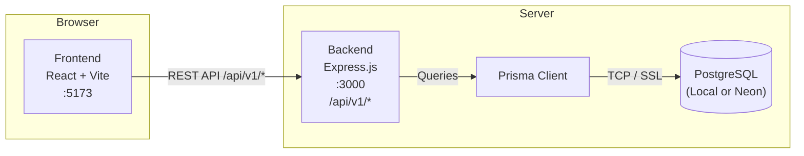
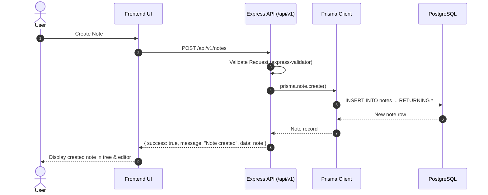

# System Architecture

## Overview

Knowledge App uses a **Monorepo** structure containing two independent applications:

- **Frontend**: React SPA served by Vite dev server (port 5173)
- **Backend**: Express.js REST API server with Prisma ORM (port 3000)
- **Database**: PostgreSQL (Local instance for development, Neon serverless PostgreSQL for deployment)

Communication is exclusively through REST API over HTTP with `/api/v1` prefix.



## Directory Structure

```
knowledge-app/
├── frontend/                 # React SPA
│   ├── src/
│   │   ├── features/         # Feature-based modules
│   │   ├── components/       # Shared UI components
│   │   ├── services/         # API client (/api/v1)
│   │   ├── routes/           # Central route definitions
│   │   ├── hooks/            # Shared utility hooks
│   │   ├── stores/           # Global state
│   │   ├── utils/            # Utilities
│   │   └── constants/        # App constants
│   └── package.json
│
├── backend/                  # Express REST API + Prisma
│   ├── prisma/
│   │   ├── schema.prisma     # Prisma data schema & relations
│   │   ├── migrations/       # SQL migration history
│   │   └── seed.js           # Database seed script
│   ├── src/
│   │   ├── modules/          # Business domain modules
│   │   ├── config/           # Prisma client & env config
│   │   ├── middlewares/      # Express middlewares
│   │   ├── utils/            # apiResponse helpers
│   │   └── constants/        # Shared backend constants
│   └── package.json
│
├── docs/                     # Documentation suite
├── AGENTS.md                 # AI agent collaboration guidelines
└── package.json              # Monorepo root workspace
```

## Technology Decisions

| Decision | Choice | Reason |
|----------|--------|--------|
| Language | JavaScript (ES6+) | Modern ES Modules, no TypeScript overhead |
| Frontend build | Vite | Fast HMR, instant startup |
| Rich text | TipTap | ProseMirror-based, rich text stored as JSONB |
| Graph | React Flow | Purpose-built for node/edge visualization |
| Backend | Express.js | Lightweight, modular REST framework |
| ORM | Prisma ORM | Type-safe queries in JS, automatic migrations, clean relational schema |
| Database | PostgreSQL | Rock-solid relational integrity, JSONB support for rich text, foreign key cascades |
| Managed DB | Neon PostgreSQL | Serverless PostgreSQL with autoscaling and branching support |
| API Prefix | `/api/v1` | Explicit API versioning |

## Data Flow


