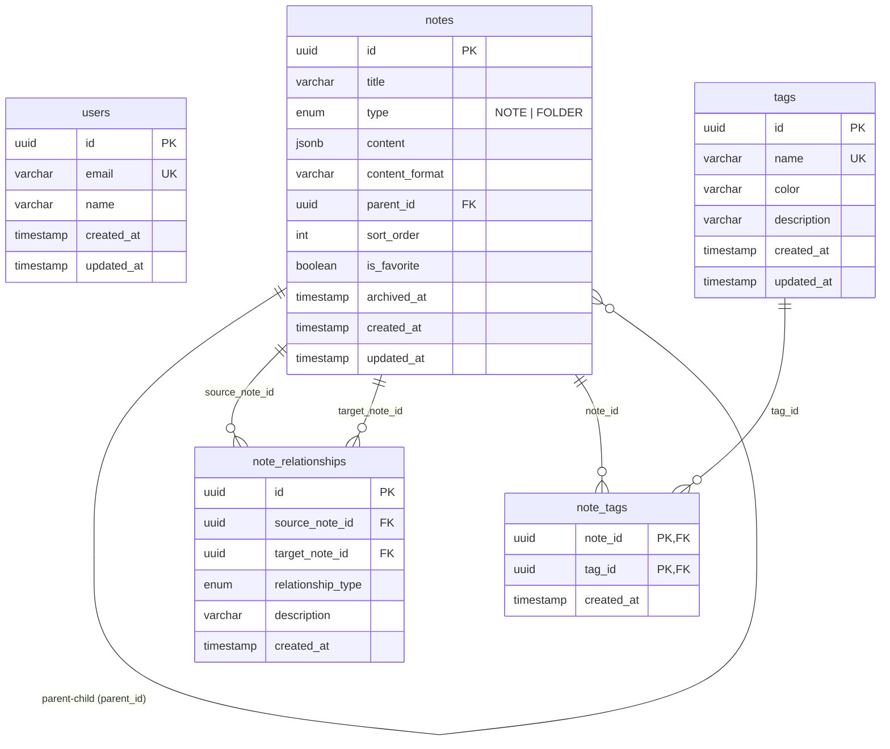

# Database Schema (PostgreSQL + Prisma)

## 1. Overview

Knowledge App uses a relational PostgreSQL database managed through Prisma ORM.

The schema uses UUID primary keys, explicit foreign key constraints, composite unique indexes, and PostgreSQL `JSONB` for rich text content.

---

## 2. Table Specifications

### `users` Table
Prepared for future multi-user authentication. Nullable for MVP.

| Column | Type | Constraints | Description |
|--------|------|-------------|-------------|
| `id` | `UUID` | `PRIMARY KEY`, Default `gen_random_uuid()` | Unique user identifier |
| `email` | `VARCHAR(255)` | `UNIQUE`, `NULLABLE` | User email address |
| `name` | `VARCHAR(100)` | `NULLABLE` | Display name |
| `created_at` | `TIMESTAMP WITH TIME ZONE` | `NOT NULL`, Default `NOW()` | Creation timestamp |
| `updated_at` | `TIMESTAMP WITH TIME ZONE` | `NOT NULL`, Auto-update | Last modification timestamp |

---

### `notes` Table
Core knowledge items (both content notes and organizational folders).

| Column | Type | Constraints | Description |
|--------|------|-------------|-------------|
| `id` | `UUID` | `PRIMARY KEY`, Default `gen_random_uuid()` | Unique note identifier |
| `title` | `VARCHAR(500)` | `NOT NULL` | Note title |
| `type` | `ENUM('NOTE', 'FOLDER')` | `NOT NULL`, Default `'NOTE'` | Discriminator between note and folder |
| `content` | `JSONB` | `NULLABLE` | TipTap ProseMirror structured document |
| `content_format` | `VARCHAR(50)` | `NOT NULL`, Default `'json'` | Content format descriptor |
| `parent_id` | `UUID` | `NULLABLE`, `FK -> notes.id (ON DELETE SET NULL)` | Hierarchy parent note ID (`NULL` for root) |
| `sort_order` | `INTEGER` | `NOT NULL`, Default `0` | Position among sibling notes |
| `is_favorite` | `BOOLEAN` | `NOT NULL`, Default `FALSE` | Favorite flag for quick access |
| `archived_at` | `TIMESTAMP WITH TIME ZONE` | `NULLABLE` | Archive timestamp (`NULL` if active) |
| `created_at` | `TIMESTAMP WITH TIME ZONE` | `NOT NULL`, Default `NOW()` | Creation timestamp |
| `updated_at` | `TIMESTAMP WITH TIME ZONE` | `NOT NULL`, Auto-update | Last modification timestamp |

#### Indexes on `notes`
- `INDEX (parent_id)`: Accelerates tree sibling and child retrieval.
- `INDEX (type)`: Filtering folders vs notes in sidebar.
- `INDEX (title)`: Fast prefix / substring searching.
- `INDEX (archived_at)`: Filtering active vs archived notes.
- `INDEX (is_favorite)`: Quick retrieval of starred notes.
- `INDEX (updated_at)`: Sorting recently updated notes.

---

### `note_relationships` Table
Independent directional connections between notes (Knowledge Graph).

| Column | Type | Constraints | Description |
|--------|------|-------------|-------------|
| `id` | `UUID` | `PRIMARY KEY`, Default `gen_random_uuid()` | Unique relationship ID |
| `source_note_id` | `UUID` | `NOT NULL`, `FK -> notes.id (ON DELETE CASCADE)` | Originating note |
| `target_note_id` | `UUID` | `NOT NULL`, `FK -> notes.id (ON DELETE CASCADE)` | Destination note |
| `relationship_type` | `ENUM` | `NOT NULL` | `RELATED_TO`, `DEPENDS_ON`, `REFERENCES`, `EXTENDS`, `CONTRADICTS` |
| `description` | `VARCHAR(1000)` | `NULLABLE` | Optional description of the connection |
| `created_at` | `TIMESTAMP WITH TIME ZONE` | `NOT NULL`, Default `NOW()` | Creation timestamp |

#### Constraints & Indexes on `note_relationships`
- `UNIQUE (source_note_id, target_note_id, relationship_type)`: Composite unique constraint preventing duplicate relationships of the same type.
- `INDEX (source_note_id)`: Quick retrieval of outgoing relationships.
- `INDEX (target_note_id)`: Quick retrieval of incoming relationships (backlinks).
- `INDEX (relationship_type)`: Graph filtering by relationship type.

---

### `tags` Table
Reusable categorization tags.

| Column | Type | Constraints | Description |
|--------|------|-------------|-------------|
| `id` | `UUID` | `PRIMARY KEY`, Default `gen_random_uuid()` | Unique tag identifier |
| `name` | `VARCHAR(100)` | `UNIQUE`, `NOT NULL` | Case-insensitive normalized tag name |
| `color` | `VARCHAR(20)` | `NULLABLE` | Optional hex color code (e.g. `#6366F1`) |
| `description` | `VARCHAR(500)` | `NULLABLE` | Optional tag description |
| `created_at` | `TIMESTAMP WITH TIME ZONE` | `NOT NULL`, Default `NOW()` | Creation timestamp |
| `updated_at` | `TIMESTAMP WITH TIME ZONE` | `NOT NULL`, Auto-update | Last modification timestamp |

---

### `note_tags` Join Table
Explicit relational join table connecting `notes` and `tags`.

| Column | Type | Constraints | Description |
|--------|------|-------------|-------------|
| `note_id` | `UUID` | `NOT NULL`, `FK -> notes.id (ON DELETE CASCADE)` | Referenced note |
| `tag_id` | `UUID` | `NOT NULL`, `FK -> tags.id (ON DELETE CASCADE)` | Referenced tag |
| `created_at` | `TIMESTAMP WITH TIME ZONE` | `NOT NULL`, Default `NOW()` | Tag assignment timestamp |

#### Constraints & Indexes on `note_tags`
- `PRIMARY KEY (note_id, tag_id)`: Composite primary key.
- `INDEX (tag_id)`: Quick lookup of notes associated with a given tag.
