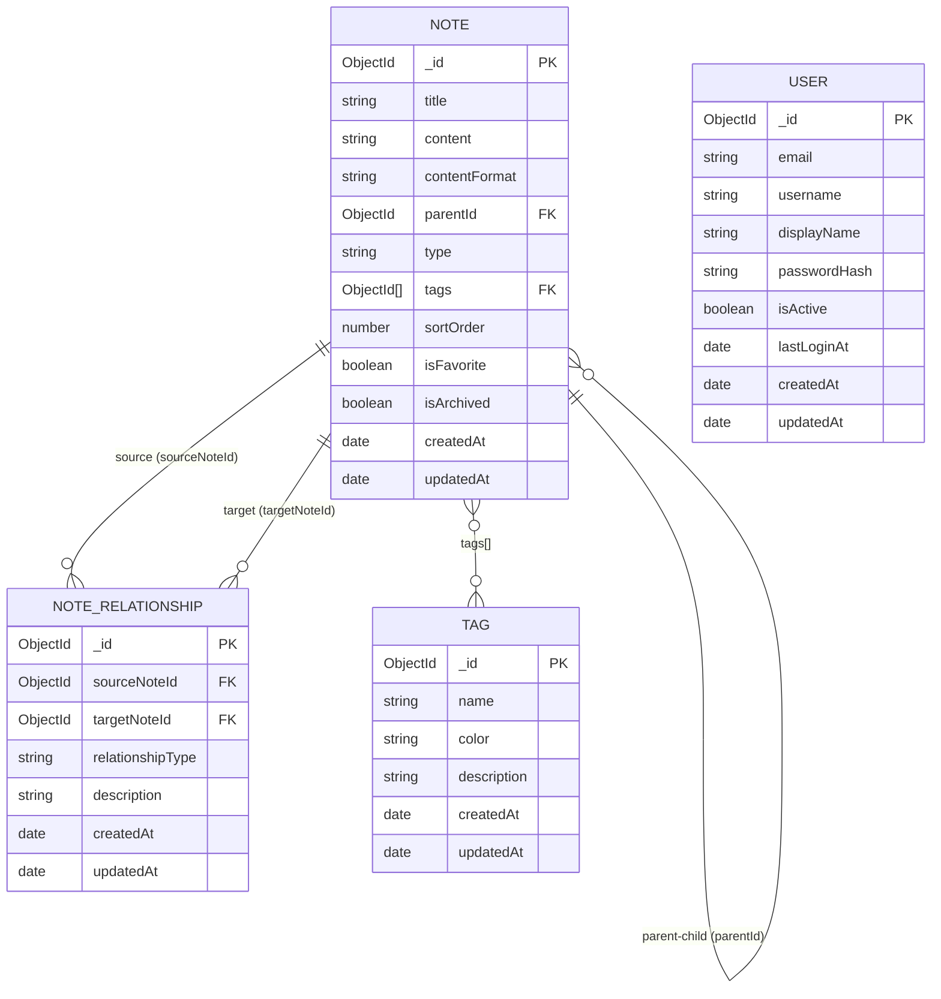

# Database Schema

## Collections Overview

| Collection | Model | Purpose |
|------------|-------|---------|
| `notes` | Note | Core knowledge items (notes and folders) |
| `noterelationships` | NoteRelationship | Independent typed relationships between notes |
| `tags` | Tag | Reusable tags for categorization |
| `users` | User | User accounts (prepared for future auth) |

---

## Note Schema

```javascript
{
  _id:           ObjectId,          // Auto-generated MongoDB ID
  title:         String,            // Required, 1-500 chars
  content:       String,            // Rich text content (HTML)
  contentFormat: String,            // 'html' | 'markdown' | 'plain'
  parentId:      ObjectId | null,   // Parent note ID, null = root
  type:          String,            // 'NOTE' | 'FOLDER'
  tags:          [ObjectId],        // References to Tag collection
  sortOrder:     Number,            // Position among siblings
  isFavorite:    Boolean,
  isArchived:    Boolean,
  createdAt:     Date,              // Auto (timestamps: true)
  updatedAt:     Date               // Auto (timestamps: true)
}
```

### Indexes
| Index | Fields | Type | Purpose |
|-------|--------|------|---------|
| default | `_id` | Unique | MongoDB default |
| hierarchy | `parentId` | Regular | Query children of a parent |
| text search | `title`, `content` | Text | Full-text search |
| list query | `isArchived`, `updatedAt` | Compound | Filter + sort |
| favorites | `isFavorite`, `updatedAt` | Compound | Favorites view |

---

## NoteRelationship Schema

```javascript
{
  _id:              ObjectId,    // Auto-generated
  sourceNoteId:     ObjectId,   // Required, ref: Note
  targetNoteId:     ObjectId,   // Required, ref: Note
  relationshipType: String,     // 'RELATED_TO' | 'DEPENDS_ON' | 'REFERENCES' | 'EXTENDS' | 'CONTRADICTS'
  description:      String,     // Optional, max 1000 chars
  createdAt:        Date,
  updatedAt:        Date
}
```

### Indexes
| Index | Fields | Type | Purpose |
|-------|--------|------|---------|
| outgoing | `sourceNoteId` | Regular | Get all outgoing relationships |
| incoming | `targetNoteId` | Regular | Get all incoming relationships (backlinks) |
| unique | `sourceNoteId`, `targetNoteId`, `relationshipType` | Unique compound | Prevent duplicates |

---

## Tag Schema

```javascript
{
  _id:         ObjectId,
  name:        String,     // Required, unique, lowercase, max 100 chars
  color:       String,     // Optional, hex color (#RRGGBB)
  description: String,     // Optional, max 500 chars
  createdAt:   Date,
  updatedAt:   Date
}
```

### Indexes
| Index | Fields | Type | Purpose |
|-------|--------|------|---------|
| unique name | `name` | Unique | Prevent duplicate tags |

---

## User Schema (Prepared, Not Active in MVP)

```javascript
{
  _id:          ObjectId,
  email:        String,     // Required, unique, lowercase
  username:     String,     // Required, unique, 3-50 chars
  displayName:  String,     // Optional
  passwordHash: String,     // select: false (excluded from default queries)
  isActive:     Boolean,
  lastLoginAt:  Date | null,
  createdAt:    Date,
  updatedAt:    Date
}
```

> [!NOTE]
> The User model is defined but not wired to notes in MVP. Future multi-user support will add `userId` to the Note schema.

---

## Entity Relationship Diagram


