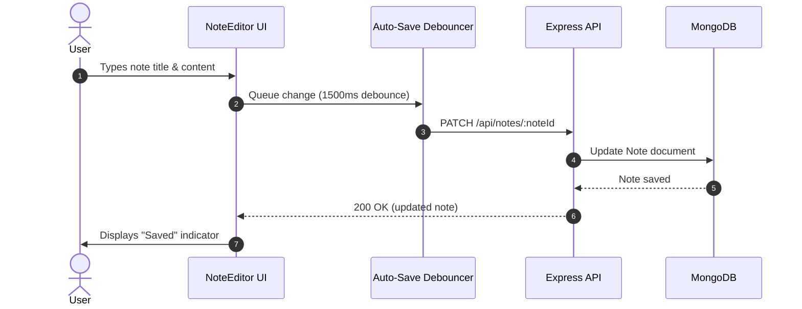
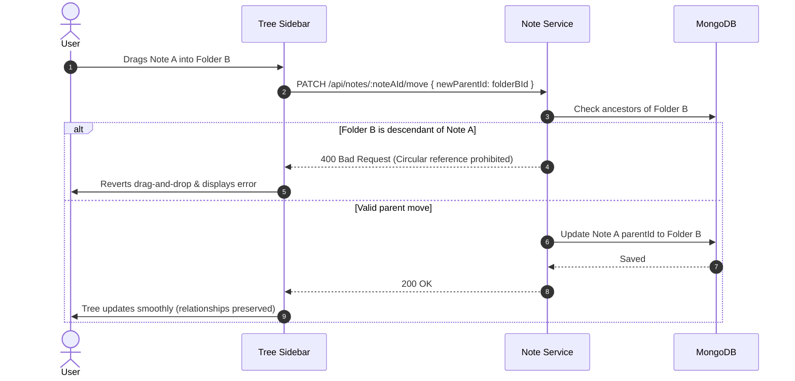

# User Flows

## Flow 1: Note Creation and Rich Text Editing



---

## Flow 2: Moving a Note in Hierarchy (Preventing Cycles)



---

## Flow 3: Creating a Knowledge Graph Relationship

```mermaid
sequenceDiagram
  autonumber
  actor User
  participant UI as Relationships Drawer
  participant API as Express API
  participant DB as MongoDB

  User->>UI: Selects "Add Connection" -> targets Note B -> selects "DEPENDS_ON"
  UI->>API: POST /api/relationships { sourceNoteId: NoteA, targetNoteId: NoteB, relationshipType: 'DEPENDS_ON' }
  API->>DB: Insert NoteRelationship document
  DB-->>API: Created
  API-->>UI: 201 Created
  UI->>User: Connection appears in Outgoing panel; Note B backlink count increments
```
