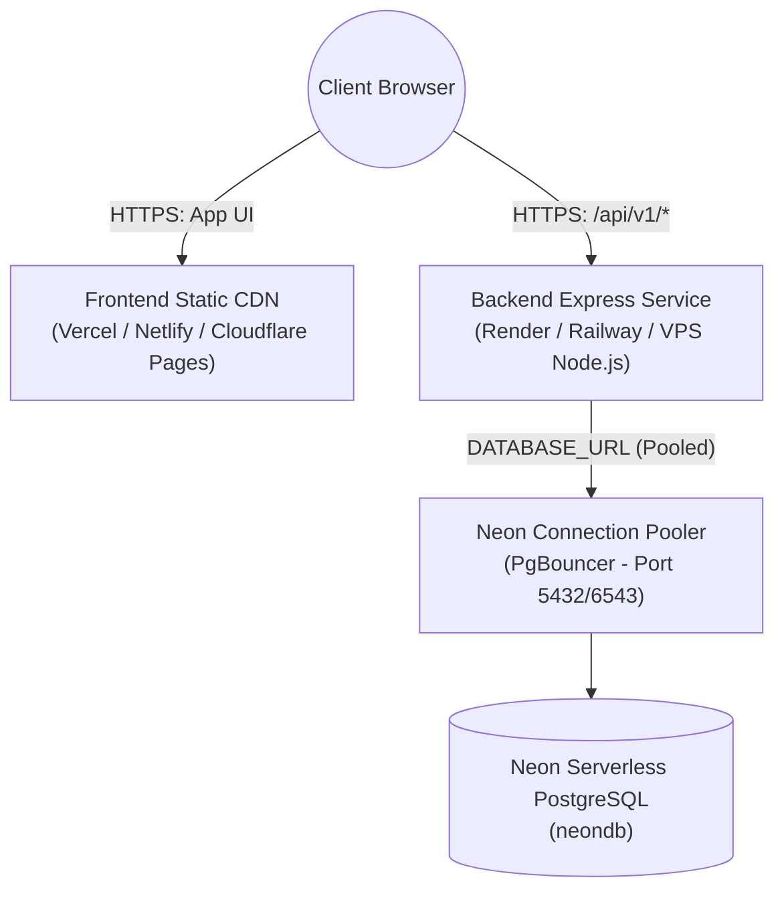

# Production Deployment Guide

## 1. Production Architecture Overview

In production, the application consists of two decoupled components connected to a managed Neon PostgreSQL database:



---

## 2. Database Provisioning on Neon

1. Provision a production project on [Neon](https://neon.tech).
2. Configure compute auto-suspend and autoscaling based on traffic requirements.
3. Retrieve connection credentials:
   - **Pooled connection string** (for runtime):
     `postgresql://<user>:<password>@ep-prod-pooler.region.neon.tech/neondb?sslmode=require&pgbouncer=true`
   - **Direct connection string** (for migrations):
     `postgresql://<user>:<password>@ep-prod.region.neon.tech/neondb?sslmode=require`

---

## 3. Backend Deployment

### Build & Migration Process
In your CI/CD pipeline or build script:
```bash
# 1. Install production dependencies
npm install --omit=dev

# 2. Generate Prisma Client
npx prisma generate --schema=backend/prisma/schema.prisma

# 3. Apply production migrations safely (non-interactive)
npx prisma migrate deploy --schema=backend/prisma/schema.prisma
```

### Production Environment Variables (Backend)
| Variable | Value Description |
|----------|-------------------|
| `NODE_ENV` | `production` |
| `PORT` | `3000` (or assigned cloud port) |
| `DATABASE_URL` | Neon pooled connection string with `?sslmode=require&pgbouncer=true` |
| `DIRECT_URL` | Neon direct connection string with `?sslmode=require` |
| `CORS_ORIGIN` | Exact production URL of the frontend (e.g. `https://app.knowledgepkm.com`) |
| `RATE_LIMIT_WINDOW_MS` | `900000` (15 minutes) |
| `RATE_LIMIT_MAX_REQUESTS` | `100` |

### Process Execution
Start the Node.js application process:
```bash
node backend/src/server.js
```

---

## 4. Frontend Deployment

### Production Build
```bash
cd frontend
npm install
npm run build
```
The compiled output is generated in `frontend/dist/`.

### Hosting Configuration
Deploy `frontend/dist/` to any static hosting provider (Vercel, Netlify, Cloudflare Pages, AWS S3/CloudFront).

**Environment Variables (Frontend)**:
- `VITE_API_BASE_URL`: `https://api.knowledgepkm.com/api/v1`

**SPA Routing Rule**:
Ensure all client-side routes (e.g. `/notes/*`, `/graph`, `/search`) rewrite to `/index.html`.

---

## 5. Production Health Verification

Verify backend service availability:
```bash
curl https://api.knowledgepkm.com/health
```
Expected response:
```json
{
  "success": true,
  "status": "healthy",
  "version": "0.1.0"
}
```
